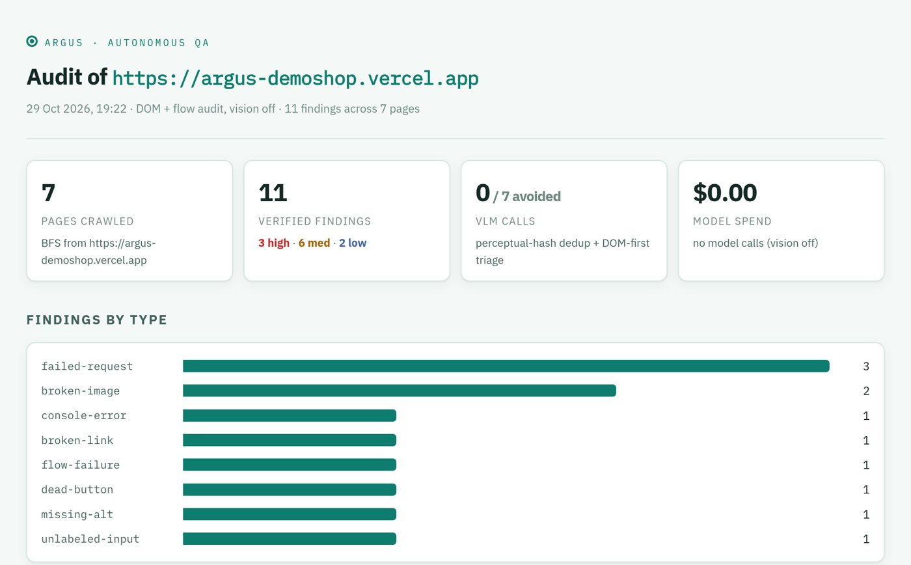
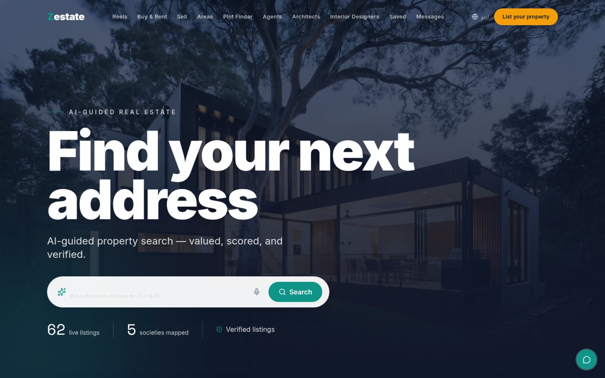
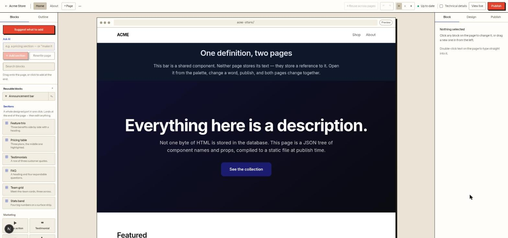
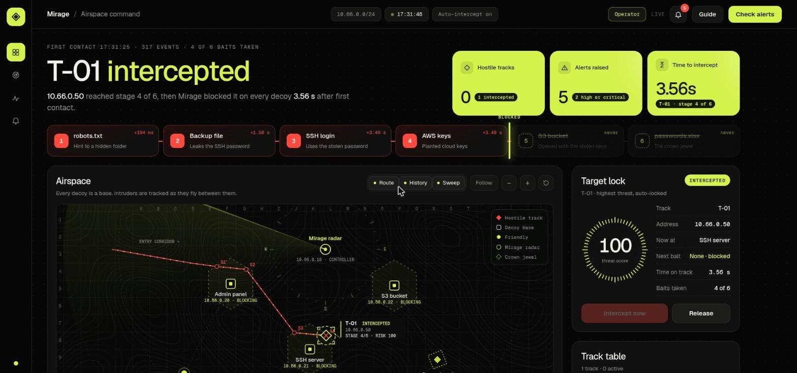
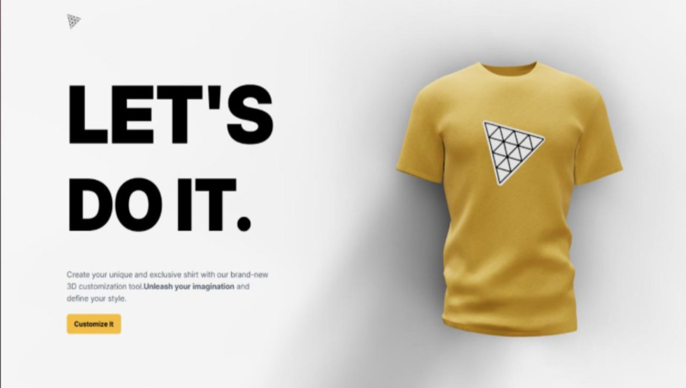
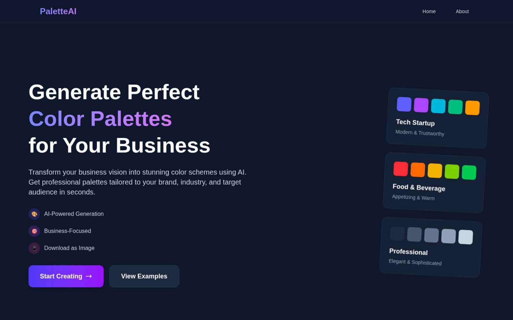
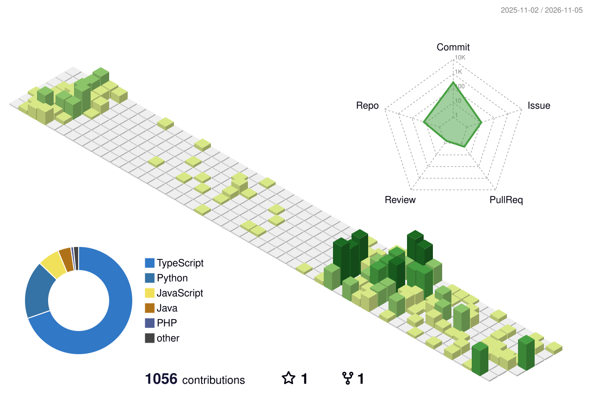

  

&nbsp;

&nbsp;

  

&nbsp;

 

## 🧭 About

- 🛠️ Full-stack & AI engineer: web products end to end, and the agents that run inside them
- 🎓 Final-year Software Engineering @ **FAST-NUCES**, Lahore · **Gold Medalist**
- 💼 Previously Software Engineer Intern @ **Tkxel** and Full Stack Engineer @ **8x** · freelancing since 2024
- 🚀 Building **[Zestate](https://zestate.co)**, a bilingual property marketplace, **live in production**
- 🤝 **Open to full-time software & AI engineering roles** → [amarwaqar15@gmail.com](mailto:amarwaqar15@gmail.com)

 

## ⚡ Featured Builds

<table width="100%">
<tr>
<td width="50%" valign="top">

<h3>👁️ Argus</h3>

An autonomous <b>AI QA engineer</b>, for $0.00 in model costs

- 🕸️ LangGraph multi-agent graph: explore → audit → verify → report
- 👀 Vision model spent only on what the DOM can't see
- ♻️ Checkpointed to SQLite: a killed run resumes mid-page
- 🧪 Skeptic agent refutes hallucinated bugs before they ship

**`Python` `LangGraph` `Playwright` `OpenCV` `Gemini`**

</td>
<td width="50%" valign="top">

<h3>🏠 Zestate</h3>

Bilingual property marketplace, <b>live in production</b>

- 🌐 Listings, projects, agents and messaging, in English and Urdu
- 📱 One Turborepo: Next.js web + Expo native app
- 🔁 550+ commits since June 2026, still shipping
- 🔒 Closed-source client build

**`Next.js` `React Native` `TypeScript` `PostgreSQL`**

</td>
</tr>
<tr>
<td width="50%" valign="top">

<h3>🏗️ CMS Website Builder</h3>

A site builder where a page is a <b>description, not HTML</b>

- 📦 Publish appends an **immutable release** in under 200 ms
- ⏪ Rollback is a **single-column update**, never a rebuild
- 🧱 Ships as a hosted site, static zip or container

**`Next.js` `TypeScript` `Prisma` `PostgreSQL` `Docker`**

</td>
<td width="50%" valign="top">

<h3>🛡️ Mirage</h3>

Cyber deception that <b>traps and contains</b> intruders

- 🪤 Fake admin panel, SSH server and S3 bucket, plus planted credentials
- 🎯 Every move mapped to MITRE ATT&CK, scored per attacker
- ⚡ First alert in 16 ms, contained in 2.4 s, 0 false alarms

**`Python` `FastAPI` `Docker` `WebSockets`** · team project

</td>
</tr>
<tr>
<td width="50%" valign="top">

<h3>👕 3D Football Kit Customizer</h3>

Real-time <b>3D product configurator</b> in the browser

- 🎨 Recolor, texture and spin a 3D shirt
- 🖼️ Apply logos, or let an image model design the print
- ✨ GSAP-driven camera transitions

**`React` `Three.js` `GSAP` `Express`**

</td>
<td width="50%" valign="top">

<h3>🎨 PaletteAI</h3>

Business idea → <b>full colour palette</b>

- 🤖 Mistral-7B turns a one-line idea into a palette with reasoning
- ⚡ Styled into swatches you can copy
- 🌐 Deployed and usable right now

**`React` `Python` `Mistral-7B`**

</td>
</tr>
</table>

 

<b>🤖 &nbsp;More AI tools</b> (click to expand)

 

| Project | What it is | Stack |
|---|---|---|
| [**PR-Insight-Bot**](https://github.com/AmarWaqar-TSKLI/PR-Insight-Bot) | GitHub Action that reviews every pull request, flags missing tests and tightens commit messages | `Python` `GitHub Actions` `OpenRouter` |
| [**AI Code Linter**](https://github.com/AmarWaqar-TSKLI/AI_Code_Linter_Repo) | Paste code, get the issues explained and a corrected version back | `FastAPI` `Transformers` `React` |
| [**DataForge Lite**](https://github.com/AmarWaqar-TSKLI/DataForge-Lite) | Upload a spreadsheet, clean it, chart it, ask it questions | `FastAPI` `Pandas` `Plotly` `React` |
| **SmartScreen AI** (private, team) | Ranks resumes against a job description with TF-IDF and classical ML | `Python` `scikit-learn` `NLP` |

<b>🌐 &nbsp;More web apps</b> (click to expand)

 

| Project | What it is | Links |
|---|---|---|
| **NYM** | Chat with groups, voice/video calls, an AI mode, polls and anonymous rooms | [Code](https://github.com/AmarWaqar-TSKLI/NYM-Next-Gen-Chat-App) |
| **KickOff Pro** | Football tournament manager: automatic fixtures, live scores, standings | [Code](https://github.com/AmarWaqar-TSKLI/KickOffPro) |
| **GameStore 2.0** | Games catalogue with trailers, reviews and wishlists | [Code](https://github.com/AmarWaqar-TSKLI/GameStore2.0) · [Live](https://game-store2-0.vercel.app) |
| **Moment NBA** | Client prototype: team pages run from Google Sheets | [Live](https://moment-nba.vercel.app) |
| **LeadQual** | Lead generation and qualification SaaS | [Code](https://github.com/AmarWaqar-TSKLI/LeadQual) |

<b>⚙️ &nbsp;Systems & DevOps: proof I'm not just a framework user</b> (click to expand)

 

| Project | What it is | Stack |
|---|---|---|
| [**TaskFlow**](https://github.com/AmarWaqar-TSKLI/taskflow-devops) | Containerised services on AWS behind a 12-stage DevSecOps pipeline (team project, in progress) | `AWS` `Docker` `GitHub Actions` |
| [**PingPong**](https://github.com/AmarWaqar-TSKLI/PingPong) | Two-player Pong written in **8088 Assembly**: paddles, ball physics, scoring | `Assembly` |
| [**JournEZ**](https://github.com/AmarWaqar-TSKLI/JournEZ) | Bus-ticket booking with schedules, routes and seats, on plain text files | `C++` `WinForms` |
| [**VoltMaster**](https://github.com/AmarWaqar-TSKLI/VoltMaster-Power-Management-Software) | Schedules appliances around peak hours and estimates the bill | `.NET` `WinForms` `SQL` |
| [**PlanForge**](https://github.com/AmarWaqar-TSKLI/Project-Planner-Resource-Allocator) | Project scheduler: completion time, overlap detection, effort per resource | `Java` |

 

## 🛠️ Stack

**Frontend & Mobile**

      

**Backend & Data**

     

**AI / Agents**

     

**Cloud & DevOps**

    

**Systems**

   

 

## 🌌 Contributions in 3D

<picture>
  <source media="(prefers-color-scheme: dark)" srcset="https://raw.githubusercontent.com/AmarWaqar-TSKLI/AmarWaqar-TSKLI/main/profile-3d-contrib/profile-night-rainbow.svg">
  
</picture>

## 🐍 The Contribution Snake

<picture>
  <source media="(prefers-color-scheme: dark)" srcset="https://raw.githubusercontent.com/AmarWaqar-TSKLI/AmarWaqar-TSKLI/output/github-snake-dark.svg">
  
</picture>

 

## 📊 Stats

<picture>
  <source media="(prefers-color-scheme: dark)" srcset="https://streak-stats.demolab.com?user=AmarWaqar-TSKLI&theme=tokyonight&hide_border=true&background=0D1117&ring=8B5CF6&fire=D946EF&currStreakLabel=8B5CF6">
  
</picture>

  

<picture>
  <source media="(prefers-color-scheme: dark)" srcset="https://github-readme-activity-graph.vercel.app/graph?username=AmarWaqar-TSKLI&theme=tokyo-night&hide_border=true&bg_color=0D1117&color=8B5CF6&line=6366F1&point=D946EF&area=true">
  
</picture>

 

## 🤝 Let's Build Something

**Open to full-time software & AI engineering roles, and freelance work.**

&nbsp;

  

